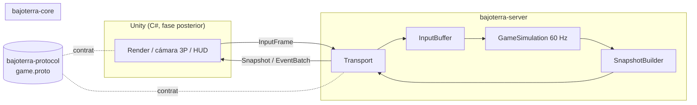

# Arquitectura

> Documento vivo. El diseño completo y las decisiones están en [plan.md](plan.md); aquí se mantiene la
> vista actual de lo que ya existe en el código.

## Vista general

## Reglas de dependencia (verificadas con ArchUnit)

- `core` no depende de `server` ni de `protocol`.
- `core` nunca lee el reloj de pared (`System.currentTimeMillis` / `nanoTime`): el tiempo es el número de tick.

## Estado por hito

| Hito | Estado |
|---|---|
| M0 Bootstrap | Hecho: JDK 27, POM multimódulo, calidad (Checkstyle, SpotBugs, JaCoCo, PIT, ArchUnit), JMH |
| M1 – M9 | Pendientes (ver [plan.md](plan.md) §8) |
