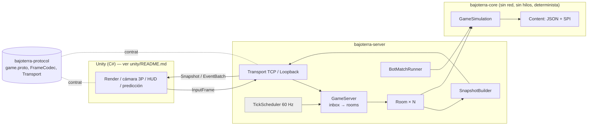

# Arquitectura

Resumen de lo que existe en el código (el razonamiento de diseño y las decisiones están en [plan.md](plan.md)).

## Módulos

| Módulo | Contenido | Depende de |
|---|---|---|
| `bajoterra-core` | simulación, combate, munición, movimientos, reglas, bots y carga de contenido | Jackson (solo al cargar) |
| `bajoterra-protocol` | `game.proto`, `FrameCodec`, `Transport`, `TransportListener` | protobuf-java |
| `bajoterra-server` | `GameServer`, `Room`, `TickScheduler`, `TcpTransport`, `LoopbackTransport`, `SnapshotBuilder`, `HeadlessClient`, `BotMatchRunner` | core, protocol |
| `bajoterra-bench` | benchmarks JMH, `SoakRunner`, `LoadRunner`, `BenchCompare` | core, server |

El cliente **Unity** (`unity/`) no es un módulo Maven: su parte sin motor (`Bajoterra.Client`: red, predicción,
interpolación, modelo del HUD) se compila y prueba con .NET contra el servidor real, y su capa visual (`Bajoterra.Unity`)
se comprueba contra la API de `UnityEngine`. Ver [unity/README.md](../unity/README.md).

Reglas (verificadas con ArchUnit): `core` no depende de `server`/`protocol`; solo `sim` conoce a los bots; los datos
puros no dependen de la fachada de simulación; los efectos y conductas integrados solo se instancian en sus fábricas.

## Un tick de simulación (`GameSimulation.tick`, 60 Hz)

1. Se aplican los `Command` en cola (`InputFrame`) al `InputState` de cada combatiente.
2. `Match.tick()`: cuenta atrás, ronda activa, fin de ronda, fin de partida (`MatchPhase`, patrón State).
3. Solo en `ROUND_ACTIVE`, con el orden de proceso **rotado cada tick** (ningún equipo se resuelve siempre primero):
   1. los bots deciden (`BotBrain.think`; planifican a 10 Hz, actúan cada tick);
   2. para cada combatiente vivo: `StatBlock.reset` → modificadores de estados → `LocomotionStateMachine` (movimientos)
      → `MovementSystem` (física y colisión con obstáculos);
   3. `FireController`: selección de ranura, intervalo entre disparos, bloqueo de 3 tiros, creación del proyectil;
   4. `ProjectileSystem.step`: barrido de esfera contra obstáculos y cápsulas; el **primer impacto** manda
      (un obstáculo delante protege al que está detrás); aplica los `Effect` de `onHit`/`onWorldHit`/`onExpire`;
   5. `StatusSet.tick` (daño/curación en el tiempo, expiración) y decaimiento del escudo extra;
   6. `PickupSystem`: recoger y reaparecer objetos.
4. Los eventos quedan en el `EventBuffer` (anillo sin asignaciones) y el servidor los envía con el snapshot.

Determinismo: RNG con semilla, sin reloj de pared, sin `HashMap` en el camino caliente y trigonometría con
`StrictMath`. `GameSimulation.stateHash()` permite comprobar que dos ejecuciones son idénticas.

## Patrones de diseño (dónde están)

| Patrón | Clases |
|---|---|
| Strategy | `Effect`, `TargetingRule`, `DamageModifier`, `MatchRules`, `SlotSelectionPolicy`, `TargetSelector`, `MoveBehavior`, `Transport` |
| Command | `Command` / `InputFrame` (humanos y bots producen lo mismo) |
| State | `MatchPhase`, `Posture` + `LocomotionStateMachine` |
| Observer / bus de eventos | `EventBuffer` → snapshots, estadísticas, percepción |
| Factory + Registry + SPI | `EffectFactory`/`EffectRegistry`, `MoveBehaviorFactory`/`MoveBehaviorRegistry`, `Registry<T>`, `ContentLoader` |
| Composite | `CompositeEffect`, `AreaEffect`, `ChainEffect`, nodos del árbol de comportamiento (`Selector`, `Sequence`) |
| Chain of Responsibility | `DamagePipeline` (elemento → vulnerabilidades → invulnerabilidad → fuego amigo) |
| Template Method | `AbstractStatusEffect` (`onApply`, `onPeriodic`, `modify`, `onExpire`) |
| Builder | `MatchConfig.Builder`, `SlugDefinition.Builder`, `ElementChart.Builder` |
| Flyweight + Object Pool | definiciones inmutables compartidas; `ProjectilePool`, `StatusSet`, `EventBuffer` |
| Facade | `GameSimulation`, `GameServer` |
| Adapter | `TcpTransport`, `LoopbackTransport` detrás de `Transport` |

## Hilos en el servidor

Un hilo de E/S (selector NIO) recibe mensajes y solo los **encola**; el único hilo de simulación vacía esa cola y
avanza las salas. Todo el estado del juego lo toca un solo hilo, así que no hay bloqueos en la simulación.

## Estado de los hitos

Todos los hitos del plan (M0–M9) están implementados; ver [performance.md](performance.md) para los números medidos.
El cliente Unity (U0–U5) está implementado y verificado salvo su ejecución en el editor; ver
[unity-handoff.md](unity-handoff.md) y [unity/README.md](../unity/README.md).
