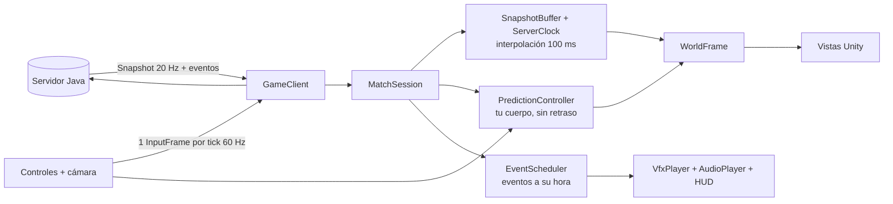

# Cliente Unity de Bajoterra Arena

Cliente en tercera persona para el servidor Java. El servidor es autoritativo (reglas, daño, colisiones, bots); el
cliente solo envía entradas y dibuja lo que recibe, más una **predicción** de su propio movimiento para que se sienta
inmediato.

> **Estado.** La lógica de red, predicción e interpolación está **probada contra el servidor Java real** (94 pruebas C#,
> incluida una partida por TCP). La capa visual (escenas generadas por código, interfaz, partículas, audio) se ha
> **ejecutado en Unity 6.6 (6000.6.7f1)**: compila sin avisos, pasan las 86 pruebas EditMode dentro del editor y una
> prueba PlayMode arranca el juego, lanza el servidor local, entra al lobby y juega una partida contra bots sin ningún
> error en consola (con capturas de cada pantalla). Lo que ninguna prueba automática valora es el *tacto*: cámara,
> puntería y equilibrio visual hay que juzgarlos jugando.

## Requisitos

| Qué | Versión | Para qué |
|---|---|---|
| Unity | **6.6 (6000.6.7f1)**, fijada en `ProjectSettings/ProjectVersion.txt` | abrir y ejecutar el proyecto |
| JDK + Maven | JDK 27, Maven 3.9 | construir y arrancar el servidor (el menú puede hacerlo por ti) |
| .NET SDK | 10 (solo para verificar) | `unity/scripts/verify.sh`, sin Unity |
| `uv` | 0.13 o posterior (opcional) | servidor del MCP de Unity (ver [abajo](#mcp-para-unity-opcional)) |

Paquetes de Unity (ya en `Packages/manifest.json`): Input System **1.20.1** (la 1.14 que se usaba antes no compila en
Unity 6.6: `TreeView` quedó obsoleto), Unity UI 2.6, Test Framework 1.8 y los módulos de audio, partículas, física y
captura de pantalla. **Active Input Handling** está en "Input System" (el código también funciona con "Both" y con el
Input Manager antiguo), el espacio de color es Linear y vale el pipeline Built-in o URP (los materiales se derivan del
material por defecto del pipeline).

## Cómo abrirlo y jugar

1. `mvn -DskipTests package` en la raíz del repositorio (genera `bajoterra-server/target/…-all.jar`), con
   `JAVA_HOME` apuntando al JDK 27.
2. Unity Hub → **Add** → carpeta `unity/BajoTerraClient`. En la primera apertura Unity genera `Library`, los `.meta` y
   crea `Assets/Scenes/Main.unity` (lo hace `ProjectSetup`).
3. **Play.** El juego se construye solo desde código (`Bootstrap` + `GameApp`), así que sirve cualquier escena.
4. En el menú principal pulsa **JUGAR** → **"Jugar contra bots"**: arranca el servidor Java como proceso hijo y se
   conecta; o escribe la dirección de un servidor que ya esté corriendo y pulsa **Conectar**. **CONTROLES** lista las teclas
   y **AJUSTES** permite cambiar sensibilidad, campo de visión, volúmenes y la información de depuración.
5. Entra a una sala, elige personaje y tus 10 babosas (o déjalas aleatorias) y pulsa **¡Listo!**. Los huecos hasta 3 contra
   3 se rellenan con bots.

También hay un menú **Bajoterra → Server** en el editor para compilar, arrancar y parar el servidor.

Para probar rápido el final de una partida y las pantallas de resultado, arranca Unity con la variable de entorno
`BAJOTERRA_SERVER_ARGS="--rules quick"`: el servidor local jugará una única ronda de 15 s.

### Controles

| Acción | Tecla |
|---|---|
| Moverse | WASD |
| Apuntar | ratón (la mira apunta donde llega la babosa) |
| Disparar | clic izquierdo (mantener) |
| Elegir babosa | 1–0, o rueda del ratón (salta las bloqueadas) |
| Saltar / agacharse / rodar / dash | Espacio / C o Ctrl / Shift / F (según el personaje) |
| Observar a otro cuando te derrotan | clic |
| Marcador de la partida (bajas, caídas, daño, curación) | Tab (mantener) |
| Pausa (reanudar, ajustes, abandonar) | Esc |
| Información de depuración (fps, ping, error de predicción) | F3 |

## Estructura

```
unity/
├─ BajoTerraClient/                    ← el proyecto que se abre en Unity
│  ├─ Assets/
│  │  ├─ Plugins/Google.Protobuf/      runtime de protobuf (y sus dependencias, con licencias)
│  │  ├─ Scripts/
│  │  │  ├─ Client/                    asmdef Bajoterra.Client — SIN referencias a Unity
│  │  │  │   ├─ Generated/Game.cs        clases del contrato (generadas desde game.proto)
│  │  │  │   ├─ Wire/ Transport/         tramas, TCP en hilos, transporte en memoria para pruebas
│  │  │  │   ├─ Session/                 GameClient (fachada), MatchSession, EventScheduler
│  │  │  │   ├─ Prediction/              modelo de movimiento portado del servidor + reconciliación
│  │  │  │   ├─ Interpolation/           reloj del servidor, buffer de snapshots, muestreo sin basura
│  │  │  │   ├─ Content/ Camera/ Input/ Hud/ Util/
│  │  │  ├─ Unity/                     asmdef Bajoterra.Unity — la capa visual
│  │  │  │   ├─ Core/ Input/ Views/ Effects/ Ui/ Net/   (texturas, mallas y sprites se dibujan en código)
│  │  │  └─ Editor/                    asmdef Bajoterra.Editor — escena inicial y menú del servidor
│  │  ├─ Resources/Shaders/             dos shaders pequeños: brillo aditivo y burbuja de escudo (borde luminoso)
│  │  ├─ Resources/Sounds/Shots/        los disparos grabados (desde sound/, con scripts/import-shot-sounds.sh)
│  │  ├─ Tests/EditMode/               pruebas NUnit (Test Runner de Unity) + fixture grabado del servidor
│  │  ├─ Tests/PlayMode/               prueba de humo: el juego real, una partida contra bots, capturas
│  │  └─ link.xml                      evita que IL2CPP recorte protobuf
│  ├─ Packages/manifest.json  ProjectSettings/ProjectVersion.txt
├─ dotnet/                             proyectos .NET que compilan LAS MISMAS fuentes sin Unity
│  ├─ Bajoterra.Client                 netstandard2.1 + C# 9 (el nivel de Unity 6)
│  ├─ Bajoterra.Client.Tests           NUnit: pruebas EditMode + integración con el servidor real
│  └─ Bajoterra.Unity.Check            compila la capa visual contra los ensamblados de UnityEngine
└─ scripts/  sync-protocol.sh  verify.sh  unity-test.sh  import-shot-sounds.sh
```

La separación en dos ensamblados es deliberada: **todo lo que puede fallar de forma sutil (red, tiempo, predicción)
vive en `Bajoterra.Client`, sin Unity, y se prueba en segundos contra el servidor real**; `Bajoterra.Unity` solo
traduce ese estado a objetos, UI y sonido.

## Cómo funciona



- **Tres relojes.** Tu personaje se dibuja *ahora* (predicción); los demás y las babosas, ~100 ms en el pasado,
  interpolados entre dos snapshots; los eventos (explosiones, daño, derrotas) se reproducen cuando el reloj de
  interpolación llega a su tick, para que coincidan con lo que se ve. Tus propios disparos suenan al instante.
- **Predicción y reconciliación** (`PredictionController`): cada tick se aplica tu entrada a un cuerpo local con las
  mismas reglas que el servidor (`MovementModel`, portado de `LocomotionStateMachine` + `MovementSystem` +
  `World.resolveCombatant`). Cuando llega un snapshot —que trae tu estado exacto en `LocalState` y el último
  `ack_sequence`— se parte de ese estado y se reaplican las entradas que el servidor aún no había visto. La diferencia se
  disuelve en ~100 ms; si supera 2 m (te empujaron, empezó una ronda) se corrige de golpe. El contenido (velocidades,
  movimientos, mapa) llega del servidor en `Welcome` y `MatchStart`, nunca está copiado en el cliente.
- **Cámara.** `ThirdPersonCamera` (sin Unity) orbita sobre el hombro, se acerca si hay un muro detrás y produce la
  posición y la dirección que se envían como `has_camera`: el servidor traza el rayo desde ahí y la babosa sale del blaster
  hacia el punto bajo la mira.
- **HUD.** `HudModel` calcula todo lo que se muestra (vida, escudo, las 10 ranuras con "vuelve en N tiros", marcador, tiempo,
  aliados, kill feed) sin usar Unity; `HudScreen` solo lo copia a widgets.

### Patrones de diseño

| Patrón | Dónde |
|---|---|
| Adapter / Strategy | `IClientTransport` (TCP, en memoria; un UDP no tocaría la sesión) |
| Facade / State | `GameClient` y su `ClientPhase` |
| Observer | eventos de `GameClient` y `MatchSession.EventPlayed` |
| Object Pool + Flyweight | `ProjectileViews`, `VfxPlayer`, `MaterialFactory` |
| Command | `PlayerInput` → `InputFrame` (el mismo valor alimenta predicción y red) |
| View-model | `HudModel` frente a `HudScreen` |
| Data-driven | todo el contenido llega por índices del `ContentManifest`; ningún id está escrito salvo para colores y teclas |

## Añadir contenido sin tocar el protocolo

- **Una babosa nueva:** nada que hacer en el cliente. Aparece en el selector del lobby (con su nombre, rol y color de
  elemento) y se dibuja con el color de su elemento. Un elemento o estado nuevo recibe un color automático
  (`Palette.Hashed`); para elegirlo, una línea en `Palette`.
- **Un movimiento nuevo:** si usa las conductas `impulse` o `drive`, se predice solo. Para asignarle tecla, una línea en
  `MoveBindings` (sin ella se le da una tecla libre); para su sonido, un `case` en `VfxPlayer.OnMove`. Una conducta con
  código propio en el servidor funciona igual, pero el cliente no la predice (el servidor corrige).
- **Arte real:** los héroes ya son modelos de Blender con esqueleto y animaciones (`unity/art/README.md`, FBX en
  `Assets/Resources/Models`); `ArenaView` (geometría) y `ProceduralAudio` (sonidos) son los puntos que quedan por sustituir
  por assets, y los datos que los alimentan no cambian. Un héroe sin FBX se dibuja con el cuerpo de primitivas.
- **Disparos:** cada disparo suena como una de las grabaciones de `sound/` (elegida al azar), más fuerte cuanto más cerca
  esté quien dispara: volumen completo hasta 4 m de la cámara y la mitad cada vez que se duplica la distancia (−8 dB a
  10 m, −22 dB de una base a la otra); igual para impactos, explosiones y pasos. Para añadir o cambiar una,
  se deja el `.mp3` en `sound/` y se ejecuta `unity/scripts/import-shot-sounds.sh` (necesita ffmpeg): recorta el silencio
  del principio y del final, la pasa a mono y la nivela a −16 LUFS en `Assets/Resources/Sounds/Shots`.

## Verificación sin Unity

```sh
unity/scripts/verify.sh        # protocolo al día, jar del servidor, pruebas + integración, compilación de la capa visual
```

| Qué se comprueba | Cómo |
|---|---|
| `Game.cs` es el generado desde `game.proto` | `sync-protocol.sh --check` |
| Tramas y bytes idénticos a los del servidor | `FrameCodecTests` (bytes dorados fijados también en Java) |
| El modelo de movimiento C# = el del servidor | `MovementParityTests` repite 8 escenarios grabados del servidor Java (andar, saltar, agacharse, rodar, dash, deslizarse por muros, subir a una cobertura de 1 m, límites del mapa) y desde cualquier estado intermedio |
| Reconciliación, interpolación, relojes, HUD, cámara, sesión | pruebas unitarias con transporte en memoria |
| Cliente real ↔ servidor real | `ServerIntegrationTests`: protocolo, 20 snapshots/s, predicción en una partida real (error mediano 0,000 m, máximo ~0,3 m, sin saltos), disparos y bloqueo de 3 tiros, selección de ranura |
| La capa visual compila con el nivel de lenguaje de Unity 6 | `Bajoterra.Unity.Check` contra `UnityEngine.Modules` (más *stubs* de UI, Input System y UnityEditor), con ambos backends de entrada |

Si cambias el movimiento en Java: la prueba `MovementParityFixtureTest` falla hasta regenerar el fixture
(`mvn -pl bajoterra-server test -Dtest=MovementParityFixtureTest -Dbajoterra.updateFixtures=true`) y entonces
`MovementParityTests` falla hasta que `MovementModel` siga al servidor.

## Pruebas dentro del editor

```sh
unity/scripts/unity-test.sh                                  # EditMode (86) + PlayMode (2) con el editor de ProjectVersion.txt
unity/scripts/unity-test.sh playmode --screenshots /tmp/bt   # además guarda una captura PNG por pantalla
```

Cierra el proyecto en el editor antes: Unity no abre dos veces el mismo proyecto. El script usa un tope de tiempo
(`UNITY_TEST_TIMEOUT`, 600 s por defecto) para que una prueba colgada no bloquee. También se pueden lanzar desde
**Window → General → Test Runner**.

- **EditMode** (`Assets/Tests/EditMode`): las 86 pruebas unitarias de la lógica sin Unity, ahora dentro del editor real.
- **PlayMode** (`Assets/Tests/PlayMode/GameSmokeTests`): arranca el juego, pulsa los botones como un jugador (menú →
  "Jugar contra bots" → sala → ¡Listo!), deja correr la partida y falla ante cualquier error o excepción en consola. Las
  capturas se hacen renderizando la cámara y la interfaz a una textura, porque la captura de fin de fotograma no se
  dispara en *batchmode*. Necesita el jar del servidor (`mvn -DskipTests package`); sin él, la prueba se omite.

## MCP para Unity (opcional)

El proyecto incluye [MCP for Unity](https://github.com/CoplayDev/unity-mcp) (MIT, v10.3.0, fijado al commit `aa5fc63`),
que deja a un asistente como Claude Code manejar el editor: escenas, scripts, assets, consola, pruebas, compilación.

1. En Unity: **Window → MCP for Unity** → **Auto-Setup** (o *Start Local HTTP Server*). Levanta
   `uvx mcpforunityserver` en `127.0.0.1:8080` (solo loopback) y conecta el editor.
2. En Claude Code, registrar una vez, desde la raíz del repositorio:
   `claude mcp add --scope local --transport http UnityMCP http://127.0.0.1:8080/mcp`
3. Comprobar con `claude mcp get UnityMCP` (debe decir *Connected* con el servidor levantado) y reiniciar la sesión de
   Claude Code para que cargue las herramientas.

Comprobado con Unity 6.6: Claude Code se conecta al servidor HTTP, y con el puente del editor activo (arranque de CI,
`-executeMethod MCPForUnity.Editor.McpCiBoot.StartStdioForCi`) el servidor lista 48 herramientas y ejecuta llamadas
reales (consola, jerarquía de escena, estado del editor).

**Privacidad:** por defecto el servidor envía telemetría de uso anónima a `api-prod.coplay.dev` (nombre de herramienta,
éxito, duración, un UUID aleatorio, sistema operativo y versión de Python; en el código revisado no se envía código
ni contenido del proyecto). Se desactiva con la variable de entorno `DISABLE_TELEMETRY=1`, que leen tanto el paquete
de Unity como el servidor; si abres Unity desde el Dock, defínela antes con `launchctl setenv DISABLE_TELEMETRY 1`.
Para quitar el MCP: borra la línea `com.coplaydev.unity-mcp` de `Packages/manifest.json` y
`claude mcp remove UnityMCP -s local`.

## Si algo no arranca

- **Errores de ensamblados `System.Memory` / `System.Runtime.CompilerServices.Unsafe` / `Google.Protobuf`:** las DLL de
  `Assets/Plugins/Google.Protobuf` (ver `THIRD-PARTY.md`) llevan *Validate References* desactivado. Si otro paquete ya
  trae alguna de ellas, borra la copia duplicada de esa carpeta.
- **"No se encontró el servidor local":** compila el jar (`mvn -DskipTests package`) o indica su ruta en las
  preferencias (`bajoterra.jar` en PlayerPrefs) / usa el menú **Bajoterra → Server → Build server jar**.
- **Java no se encuentra al lanzar desde el Dock en macOS:** Unity no hereda el `PATH` de la terminal; define `JAVA_HOME`
  o abre Unity desde una terminal.
- **Materiales rosas:** el pipeline activo no es Built-in ni URP; el proyecto no depende de ningún shader concreto, pero
  HDRP no está contemplado.
- **El ratón no gira / la UI no responde:** revisa *Edit → Project Settings → Player → Active Input Handling*; los tres
  valores están soportados, pero la UI necesita el paquete Input System o `StandaloneInputModule`.
- **WebGL / móviles:** no soportados (sockets TCP y procesos). Escritorio solamente.
